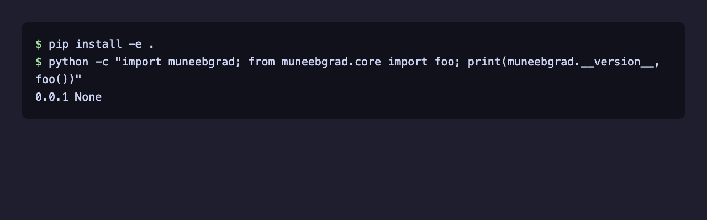

# muneebgrad

An [nbdev](https://nbdev.fast.ai) project scaffold. It is at an early stage (v0.0.1): the package contains a single placeholder function, `muneebgrad.core.foo`, which does nothing.



*Output of the command shown, run after `pip install -e .`.*

## Install

From a clone (requires Python >= 3.9):

```sh
git clone https://github.com/moneebullah25/muneebgrad.git
cd muneebgrad
pip install -e .
```

Or directly from GitHub:

```sh
pip install git+https://github.com/moneebullah25/muneebgrad.git
```

The package is not published on PyPI.

## Development

Source of truth is the notebooks in `nbs/`; `muneebgrad/*.py` are generated by nbdev. Requires `nbdev` (and Quarto for docs).

```sh
nbdev_prepare   # export, test and clean notebooks
```

CI (`.github/workflows/test.yaml`) runs the fastai `nbdev-ci` workflow; `deploy.yaml` publishes the Quarto docs to GitHub Pages.

## License

Apache 2.0, see [LICENSE](LICENSE).
